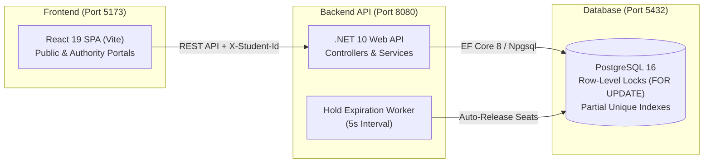

# Hashmat Uddin High School Online Admission System (HSUS)

A full-stack web application for school admissions featuring real-time seat reservation, first-come first-served queueing, database-level concurrency control, and administrative analytics developed for the Onnorokom Projukti Limited Assistant Software Engineer recruitment assessment.

---

## Architecture Overview



### Key Technology Stack
- **Frontend**: React 19, React Router 7, Vite, Lucide React, vanilla CSS tokens matching original website.
- **Backend**: C# ASP.NET Core (.NET 10), Entity Framework Core 8.0.11, Npgsql PostgreSQL provider 8.0.11, Swashbuckle OpenAPI 6.6.2.
- **Database**: PostgreSQL 16 Alpine, EF Core Code-First migrations, partial unique indexes, check constraints.
- **Orchestration**: Docker & Docker Compose with persistent storage, parameterized environment configuration, and container healthchecks.

---

## Quick Start with Docker Compose

Running the entire full-stack system requires a single command:

```bash
docker compose up --build
```

Once started, the services will be accessible at:
- **Frontend Portal**: [http://localhost:5173](http://localhost:5173)
- **Backend API & Swagger Documentation**: [http://localhost:8080/swagger](http://localhost:8080/swagger)
- **Backend Health Check**: [http://localhost:8080/health](http://localhost:8080/health)
- **PostgreSQL Database**: `localhost:5432`

To shut down:
```bash
docker compose down
```

To shut down and wipe the database volume:
```bash
docker compose down -v
```

---

## Beginner-Friendly PostgreSQL & Docker Setup Guide

If you are new to PostgreSQL, Docker, or database administration, this section provides step-by-step guidance on how the database operates, where data is saved, and how to inspect tables using simple commands.

### 1. Database Credentials & Configuration

When running via Docker Compose, PostgreSQL is automatically configured with the following credentials:

| Parameter | Value | Description |
|---|---|---|
| **Database Host** | `localhost` (from your computer) or `postgres` (inside Docker network) | The address where PostgreSQL listens |
| **Port** | `5432` | Standard PostgreSQL port mapped to your host |
| **Database Name** | `hsus_admission` | The primary production database |
| **Username** | `hsus_user` | Dedicated application user |
| **Password** | `hsus_password` | Dedicated application user password |
| **Connection String** | `Host=localhost;Port=5432;Database=hsus_admission;Username=hsus_user;Password=hsus_password` | Full standard connection string |

### 2. Automatic Database Migrations & Initial Seed Data

You **do not** need to manually run SQL scripts to create tables.
- When the backend container boots up, it automatically applies all pending EF Core migrations (`DatabaseInitializer.InitializeAsync`).
- If the database is fresh and `SEED_DEMO_DATA=true` (the default in Docker Compose for evaluation), it automatically populates standard admission classes for Session 27 (Class 6 through Class 10 Morning & Day shifts). In production, set `SEED_DEMO_DATA=false`.
- If tables already exist, seed data is safely skipped (idempotent).

### 3. Environment Variables & Configuration

The application is fully configurable via `.env` or Docker Compose environment variables:

| Variable | Default Value | Description |
|---|---|---|
| `POSTGRES_DB` | `hsus_admission` | PostgreSQL database name |
| `POSTGRES_USER` | `hsus_user` | PostgreSQL database username |
| `POSTGRES_PASSWORD` | `hsus_password` | PostgreSQL database password |
| `HOLD_DURATION_SECONDS` | `600` | Duration of temporary seat reservation (10 minutes) |
| `EXPIRATION_CHECK_INTERVAL_SECONDS` | `5` | Frequency of background worker auto-reclaiming expired holds |
| `SEED_DEMO_DATA` | `true` (Compose) / `false` (Prod) | Controls whether sample classes are seeded on an empty database |
| `CORS_ALLOWED_ORIGINS` | `http://localhost:5173,http://127.0.0.1:5173` | Comma-separated list of permitted CORS frontend origins |
| `ASPNETCORE_ENVIRONMENT` | `Production` | ASP.NET Core environment profile |

---

## Concurrency Protection & Multi-Process Architecture

The system enforces seat reservation limits and global single-admission rules exclusively at the **PostgreSQL database level**:
- **Pessimistic Row-Level Locks**: Uses PostgreSQL `SELECT ... FOR UPDATE` with deterministic lock ordering (`students` row first, `admission_classes` row second), preventing deadlocks.
- **Partial Unique Index**: `IX_AdmissionHolds_StudentId_ActiveOrConfirmed` on `(StudentId)` where `Status IN ('HELD', 'CONFIRMED')` guarantees at most one active or confirmed admission per candidate school-wide.
- **Cross-Process Concurrency Safety**: Because locks and constraints reside within PostgreSQL itself, multiple backend processes or container replicas sharing the same database can operate concurrently without race conditions, double allocation, or memory synchronization bottlenecks.

---

## Authority Security & Prototype Note

The authority portal is protected by a client-side passcode verification gate (`admin2026`). For this recruitment prototype, administrative APIs (`POST /classes`, `PUT /timeline`) are accessible to the frontend client. In a real-world enterprise deployment, server-side JWT authentication and Role-Based Access Control (RBAC) should be layered onto all administrative write endpoints.

---

## Beginner-Friendly Database Inspection Guide

You can connect directly to the database running inside the Docker container using the built-in PostgreSQL command-line tool `psql`:

#### Open an Interactive Database Shell
```bash
docker exec -it hsus_postgres psql -U hsus_user -d hsus_admission
```

Once inside `psql`, use these essential commands:

#### List all tables in the database
```sql
\dt
```
*Expected output*: `admission_classes`, `admission_holds`, `students`, `__EFMigrationsHistory`.

#### View Table Structure (Columns, Types, Constraints, and Indexes)
```sql
\d admission_classes
\d admission_holds
\d students
```

#### View All Admission Classes and Current Seat Counts
```sql
SELECT "Id", "Name", "TotalSeats", "FeeAmount", "AcademicSession" 
FROM admission_classes;
```

#### View All Active Seat Holds & Statuses
```sql
SELECT "HoldId", "StudentId", "ClassId", "Status", "ExpiresAt", "CreatedAt" 
FROM admission_holds 
ORDER BY "CreatedAt" DESC;
```

#### Exit the `psql` Terminal
```sql
\q
```

### 4. Running Quick SQL Queries from the Host Terminal

You can run single queries without opening an interactive shell by passing `-c "<query>"`:

```bash
# Check how many students have registered
docker exec hsus_postgres psql -U hsus_user -d hsus_admission -c "SELECT COUNT(*) FROM students;"

# Check total confirmed admissions vs active holds
docker exec hsus_postgres psql -U hsus_user -d hsus_admission -c "SELECT \"Status\", COUNT(*) FROM admission_holds GROUP BY \"Status\";"
```

### 5. Safe Database Reset

If you want to clear all test records and restore the database to an empty initial state:

```bash
docker exec hsus_postgres psql -U hsus_user -d hsus_admission -c "TRUNCATE TABLE admission_holds, admission_classes, students CASCADE;"
```

---

## Local Development (Without Docker)

### Prerequisites
- [.NET 8 SDK or .NET 10 SDK](https://dotnet.microsoft.com/download)
- [Node.js 20+](https://nodejs.org/)
- Running PostgreSQL 16 server on `localhost:5432`

### 1. Backend Setup
```bash
# Navigate to backend directory
cd backend/src/Hsus.Admission.Api

# Set environment variables (or copy from .env.example)
export POSTGRES_HOST=localhost
export POSTGRES_PORT=5432
export POSTGRES_DB=hsus_admission
export POSTGRES_USER=hsus_user
export POSTGRES_PASSWORD=hsus_password

# Run the API server (listens on http://localhost:8080)
dotnet run
```

### 2. Frontend Setup
```bash
# Navigate to frontend directory
cd frontend

# Install dependencies (if not already installed)
npm install

# Start Vite development server
npm run dev
```
The frontend will start on [http://localhost:5173](http://localhost:5173).

---

## Automated Testing

### 1. Backend Integration Tests (.NET & PostgreSQL)
The backend includes 20 automated integration tests covering the complete admission lifecycle, student identity validation, hold expiration, cancellation, and multi-client concurrency bursts.

```bash
dotnet test backend/tests/Hsus.Admission.IntegrationTests/Hsus.Admission.IntegrationTests.csproj
```
*Results: 20/20 Passed (100% pass rate).*

### 2. Frontend Automated Tests (React & DOM Verification)
The frontend includes 88 test assertions validating route integrity, state machine transitions, global single-admission rules, authority verification gate, and responsive design breakpoints.

```bash
cd frontend && npm test
```
*Results: 88/88 Assertions Passed (100% pass rate).*

---

## API Specification Summary

| Method | Endpoint | Description |
|---|---|---|
| `POST` | `/classes` | Create new admission class (`{ "name": "...", "totalSeats": 120 }`) |
| `GET` | `/classes` | List all classes with live calculated seats |
| `GET` | `/classes/{id}` | Get class details and seat matrix |
| `POST` | `/classes/{id}/holds` | Reserve a temporary seat hold (Requires `X-Student-Id`) |
| `GET` | `/holds/{id}` | Get hold details & remaining seconds (Requires `X-Student-Id`) |
| `POST` | `/holds/{id}/confirm` | Confirm hold and complete admission (Requires `X-Student-Id`) |
| `DELETE` | `/holds/{id}` | Cancel hold and restore seat (Requires `X-Student-Id`) |
| `GET` | `/me/holds` | Get all holds for a candidate (Requires `X-Student-Id`) |
| `GET` | `/timeline` | Get admission session schedule |
| `PUT` | `/timeline` | Update admission session schedule |
| `GET` | `/swagger` | Interactive Swagger UI documentation |

---

## Verification & Deliverables Checklist

- [x] Full .NET 10 Web API with C# clean layered architecture.
- [x] PostgreSQL database design with EF Core Code-First migrations.
- [x] Strict 17-digit birth registration number student validation.
- [x] Concurrency protection via PostgreSQL pessimistic row-level locking (`FOR UPDATE`).
- [x] Global single-admission rule enforced by database partial unique index.
- [x] 10-minute hold expiration with periodic background worker.
- [x] 20 automated backend integration tests executed against real PostgreSQL (100% pass rate).
- [x] 88 frontend automated tests verified (100% pass rate).
- [x] Dockerfile for backend (.NET 10 multi-stage build).
- [x] Dockerfile for frontend (React 19 + Nginx Alpine).
- [x] Root `docker-compose.yml` orchestrating postgres, backend, and frontend.
- [x] Comprehensive beginner-friendly database setup & inspection documentation.

