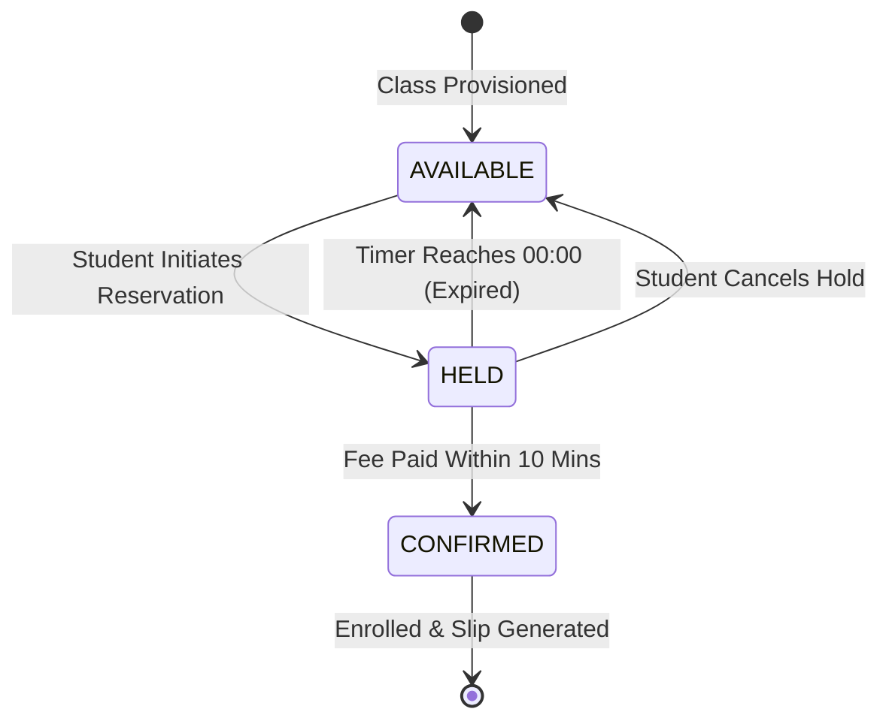

# Hashmat Uddin High School — Online Admission System
## Complete Design Specification & Architectural Report

---

### Executive Summary

This document presents the complete design, architectural specification, user role experiences, page-by-page feature breakdowns, dynamic state transition lifecycles, and design evolution for the **Hashmat Uddin High School (Nagua, Sadar, Kishoregong)** Online Admission System (Session 2027).

The application is an enterprise-grade, responsive single-page web application (SPA) built strictly with **HTML5, CSS3, and Vanilla JavaScript (ES6+)** with **zero external dependencies, zero CSS frameworks (no Tailwind/Bootstrap), and zero build tools**. All application state, student records, class quotas, session timers, and administrative configurations persist reactively through a simulated RESTful asynchronous API layer backed by browser `localStorage` and `sessionStorage`.

---

## 1. System Architecture & Core Technology Stack

```
┌────────────────────────────────────────────────────────────────────────┐
│                        HASHMAT UDDIN HIGH SCHOOL                       │
│                   Online Admission Architecture (SPA)                  │
└────────────────────────────────────────────────────────────────────────┘
                                    │
           ┌────────────────────────┴────────────────────────┐
           ▼                                                 ▼
┌──────────────────────┐                          ┌──────────────────────┐
│    STUDENT PORTAL    │                          │   AUTHORITY PORTAL   │
│   (Public / Open)    │                          │ (Passcode Protected) │
└──────────┬───────────┘                          └──────────┬───────────┘
           │                                                 │
           │      Hash-Based Client Router (`js/router.js`)  │
           └────────────────────────┬────────────────────────┘
                                    ▼
┌────────────────────────────────────────────────────────────────────────┐
│                      REACTIVE CORE INFRASTRUCTURE                      │
├────────────────────────────────────────────────────────────────────────┤
│ • State Management (`js/state.js`)      : Pub/Sub Reactive Store       │
│ • Mock Backend API (`js/mockApi.js`)    : Async Network Emulation      │
│ • Local Storage Engine (`js/store.js`)  : Multi-entity Relational DB   │
│ • Shared UI Library (`js/components.js`): Accessible Reusable Modals   │
│ • Page Renderers (`js/pages.js`)        : Declarative DOM Generators   │
│ • Utility Primitives (`js/utils.js`)    : Validation, Timers, SVGs     │
└────────────────────────────────────────────────────────────────────────┘
```

### Core Design Philosophy & Constraints
1. **Zero External Dependencies:** Built entirely with standard Web APIs (DOM, Web Storage API, CSS Custom Properties, SVG).
2. **Pure Dual-Role Isolation:** The Student Portal is intuitive, public-facing, and applicant-centric; the Authority Portal is strictly gated by a password verification layer (`admin2026` or `admin123`) and hidden from all public navigation and footers.
3. **Atomic Single-Seat Constraint:** Enforces Bangladesh educational board standards where a 17-digit birth registration number can hold or confirm at most **one** seat across the entire school.
4. **Time-Deterministic Quotas:** Live 10-minute reservation holds operate against absolute UTC timestamps, preventing clock manipulation, race conditions, and phantom reservations.
5. **Fluid & Accessible Layouts:** Implements modern CSS Grid, Flexbox, custom typography tokens, fluid responsive breakpoints (from 320px mobile to 4K ultra-wide), and high-contrast accessibility standards.

---

## 2. Role-Based Access Model & User Personas

| Dimension | Role 1: Student / Applicant | Role 2: Authority / Administrator |
|---|---|---|
| **Primary Objective** | Explore classes, reserve a seat, pay admission fees, and obtain an official admission slip. | Monitor live capacities, adjust admission schedules, create new sections, and inspect student rosters. |
| **Authentication** | 17-Digit Birth Registration Number (National ID standard). No password required. | Administrative Passcode Gate (`admin2026` / `admin123`) with secure session storage. |
| **Data Visibility** | Own application history, active reservation countdown, and live public seat quotas. | School-wide capacity KPIs, revenue totals, admitted/held student rosters, and administrative tools. |
| **Access Restrictions** | Strictly restricted to 1 active hold or confirmed admission; cannot access admin routes. | Full CRUD authority over sections, class rosters, and live admission start/closing schedules. |
| **Default Entry Route** | `#/` (Homepage) | `#/authority/admission-management` (Redirects to password gate if locked). |

---

## 3. Global Navigation & Layout Shell

### 3.1 Student Portal Navigation Shell
* **Header / Navbar:**
  - **School Crest & Branding:** Institutional crest with bold school name *"Hashmat Uddin High School"*.
  - **Institutional Location:** Displays *"Nagua, Sadar, Kishoregong"* directly under the school name.
  - **Centered Page Navigation:**
    - `Home` (`#/`)
    - `Admission` (`#/admissions/classes`)
    - `Info` (`#/admission-info`)
    - `My Applications` (`#/my-applications`)
  - **Applicant Identity Bar (Right):**
    - Masked 17-digit Student ID pill (e.g., `2008 •••• •••• 5678`).
    - Styled **"Change"** button opening the Student ID Switcher modal.
* **Global Footer:**
  - Institutional summary, school contact address, official hotline, office hours, and copyright notice.
  - **Strict Security Rule:** Contains zero links, buttons, or hints leading to the Authority Portal.

### 3.2 Authority Portal Navigation Shell
* **Header / Navbar:**
  - **Branding & Location:** Retains identical school crest, school name, and *"Nagua, Sadar, Kishoregong"* location for institutional visual continuity.
  - **Centered Admin Navigation:**
    - `Dashboard` (`#/authority/admission-management`)
    - `New Class` (`#/authority/create-class`)
    - `Statistics` (`#/authority/statistics`)
  - **Administrative Actions (Right):**
    - **"Sign Out"** Button: Clears admin session token from `sessionStorage` and safely returns to the public homepage.
    - **"Student Portal"** Button: Seamlessly switches to the public student interface in a single click.

---

## 4. Comprehensive Page-by-Page Feature Directory

```
========================================================================================
                          PAGE ROUTING & COMPONENT DIRECTORY
========================================================================================

  ROLE 1: STUDENT PORTAL (PUBLIC)
  ├── 1. Homepage / Landing Page          : `#/`
  ├── 2. Admission Information Page       : `#/admission-info`
  ├── 3. Class Selection & Matrix         : `#/admissions/classes`
  ├── 4. Public Class Details             : `#/admissions/classes/:classId`
  ├── 5. My Applications Hub              : `#/my-applications`
  └── 6. Application Details & Slip       : `#/applications/:holdId`

  ROLE 2: AUTHORITY PORTAL (ADMINISTRATIVE)
  ├── 7. Authority Verification Gate      : `#/authority/*` (when locked)
  ├── 8. Authority Dashboard Hub          : `#/authority/admission-management`
  ├── 9. Create Admission Class           : `#/authority/create-class`
  ├── 10. Admission Statistics & Charts   : `#/authority/statistics`
  └── 11. Class Details & Student Rosters : `#/authority/classes/:classId`

  GLOBAL INTERACTIVE MODALS
  ├── M1. Change Student ID Dialog        : Triggered from navbar / my applications
  ├── M2. Update Admission Window Dialog  : Triggered from Authority Hub
  ├── M3. Payment Confirmation Dialog     : Triggered from Application Details
  └── M4. Student Admission Profile Modal : Triggered from Authority Rosters
========================================================================================
```

---

### Page 1: Student Landing / Homepage (`#/`)
* **Purpose:** Serves as the primary public welcome and conversion hub for prospective students and guardians for Academic Session 2027.
* **Layout & Visual Structure:**
  1. **Hero Section (Dual-Column Clean Layout):**
     - **Left Column:**
       - Category badge: *"Admission Open 2027"*.
       - Main Title: *"Secure Your Seat for 2027!"*.
       - Highlighted Tagline: *"First to Apply, First to Belong"* rendered in a bold, prominent brand highlight box (`.hero-tagline-highlight`).
       - Concise introduction describing the automated, transparent seat allocation process for Classes 6 through 10.
       - Direct action button: *"Explore Admission Classes"* (navigates to `#/admissions/classes`) and secondary link *"Admission Guidelines"* (`#/admission-info`).
     - **Right Column:**
       - High-visibility bright countdown clock (`.hero-timer-bright`) featuring dynamic Amber/Gold LED styling with Days, Hours, Minutes, and Seconds.
       - Official start and closing dates for Session 2027.
     - **Seamless Visual Presentation:** Zero dividing horizontal border lines; natural transition into content.
  2. **Academic Structure Banner & Quick Explorer:**
     - Light gray background (`var(--bg-app)`).
     - Centered pill banner (`.academic-classes-banner`) highlighting:
       - *"Class 6 to 10"*
       - *"Morning & Day Shifts"*
       - *"Science, Arts & Commerce Disciplines"*
     - Interactive preview grid featuring live seat statuses (Open / Fast Filling / Full) with direct links to class details.
  3. **4-Step Admission Journey:**
     - Step 1: Select Class & Shift.
     - Step 2: 10-Minute Temporary Seat Hold.
     - Step 3: Online Fee Payment & Verification.
     - Step 4: Official Admission Slip Generation.
  4. **Institutional Policies & Seat Allocation Notice:**
     - Highlights first-come, first-served merit queue, single-active-seat policy, and strict countdown boundaries.

---

### Page 2: Admission Information Page (`#/admission-info`)
* **Purpose:** Provides institutional guidelines, shift schedules, official tuition fees, and candidate helpdesk channels.
* **Layout & Visual Structure:**
  1. **Clean Unified Background:** Set to `var(--bg-app)` with generous section spacing (`space-16`) and no separating horizontal lines.
  2. **School Shift Times Section:**
     - Modern card grid detailing official operating hours:
       - **Morning Shift:** `07:30 AM – 12:00 PM`
       - **Day Shift:** `12:30 PM – 05:00 PM`
  3. **Official Fee Schedule Matrix (Classes 6 to 10):**
     - Responsive, centered data table with centered column headers and cells.
     - Clear breakdown of admission fees:
       - *Class 6 (General):* ৳ 1,500
       - *Class 7 (General):* ৳ 1,500
       - *Class 8 (General):* ৳ 1,500
       - *Class 9 (Science):* ৳ 1,800
       - *Class 9 (Business Studies / Commerce):* ৳ 1,600
       - *Class 9 (Humanities / Arts):* ৳ 1,500
       - *Class 10 (Science):* ৳ 1,800
       - *Class 10 (Business Studies / Commerce):* ৳ 1,600
       - *Class 10 (Humanities / Arts):* ৳ 1,500
  4. **Admission Guidelines & Policies:**
     - Clear instructions regarding mandatory 17-digit birth certificates, single seat holds, and fee payment deadlines.
  5. **Direct Explore Action:** Prominent button to *"Explore Admission Classes"*.
  6. **Admission Helpdesk & Offline Support Section:**
     - Positioned immediately following the explore button:
       - **Campus Help Desk:** In-person assistance at the school administration office (*Nagua, Sadar, Kishoregong*).
       - **Helpline Hotline:** Direct telephone support during working hours.
       - **Office Hours & Email Support:** Dedicated academic admission inquiries mailbox.

---

### Page 3: Class Selection & Quota Matrix (`#/admissions/classes`)
* **Purpose:** Public catalog enabling applicants to inspect live seat availability across classes and shifts and initiate an application.
* **Features & Dynamic Controls:**
  1. **Dynamic Filter Controls:**
     - **Class Filter:** All, Class 6, Class 7, Class 8, Class 9, Class 10.
     - **Shift Filter:** All Shifts, Morning Shift, Day Shift.
     - **Instant Search:** Real-time text search filtering by section name or discipline group.
  2. **Single-Hold Global Alert Banner:**
     - If the active 17-digit student already has a pending reservation or confirmed admission anywhere in the school, a prominent contextual banner appears warning that multiple applications are restricted, with a direct link to view their active application.
  3. **Interactive Class Card Grid:**
     - Each card displays:
       - Class title and academic session (Session 27).
       - Badges for Shift (Morning / Day) and Group (General, Science, Arts, Commerce).
       - Prominent Admission Fee badge (e.g. `৳1,500`).
       - Two-column seat indicator: **Total Seats** vs **Available Seats**.
       - Real-time seat status badge: `Available` (Emerald), `Few Seats Left` (Amber), or `Full` (Rose).
       - *"Select This Class"* button directing to the dedicated class details page.

---

### Page 4: Public Class Details Page (`#/admissions/classes/:classId`)
* **Purpose:** Dedicated section landing page where a student locks in a 10-minute temporary seat reservation.
* **Features & Visual Elements:**
  1. **Prominent Class Header & Noticeable Info Row:**
     - Class title (e.g. *"Class 6 - Morning"*).
     - Bold, clearly visible meta strip directly beneath the title showing:
       - **Shift:** Morning Shift / Day Shift
       - **Discipline Group:** General / Science / Commerce / Arts
       - **Session:** Academic Session 2027
       - **Admission Fee:** Official BDT fee (e.g. ৳ 1,500)
  2. **Live Capacity Quota Matrix (4 Centered Metric Cards):**
     - Total Capacity
     - Admitted (Confirmed)
     - Reserved (Held)
     - Available Seats
     - Dynamic progress bar illustrating current occupancy.
  3. **Live Admission Window Countdown:**
     - Live ticking countdown displaying remaining days, hours, minutes, and seconds until the admission window closes.
  4. **Seat Reservation Action Panel:**
     - **17-Digit Birth Registration Input:** Pre-populated with the candidate's active ID (or auto-generates a valid 17-digit ID if empty).
     - **"Reserve a Seat in This Class" Button:**
       - Displays an inline loading spinner upon click.
       - Validates global single-hold constraints and seat availability.
       - On success, decrements available seats, increments held seats, initializes the 10-minute countdown, and redirects immediately to the Application Details page (`#/applications/:holdId`).
       - If the student already holds or confirmed another class, the button is disabled and contextual guidance is shown.

---

### Page 5: My Applications Hub (`#/my-applications`)
* **Purpose:** Private applicant dashboard displaying active holds, confirmation history, and previous records for the current 17-digit student ID.
* **Features & Layout:**
  1. **Clean Background:** Seamless light gray background (`var(--bg-app)`).
  2. **Centered Candidate Identity Bar:**
     - Omission of redundant "My Applications" heading.
     - Prominent centered student identity card displaying the **full unmasked 17-digit Birth Registration Number**.
     - Quick-action **"Change ID"** button to switch student identities.
  3. **Active Reservation Card (when a hold exists):**
     - Displays held class name, shift, group, fee, and live ticking 10-minute countdown timer.
     - Direct CTA: *"Pay Admission Fee"* and *"Cancel Reservation"*.
  4. **Confirmed Admission Records:**
     - Displays verified admission details, official Application Serial Number (e.g. `HUHS-2026-XXXXXX`), fee receipt confirmation, and *"View Admission Slip"* action.
  5. **Historical Logs:**
     - Displays past expired or cancelled holds for complete transparency.

---

### Page 6: Application Details & Admission Slip (`#/applications/:holdId`)
* **Purpose:** Individual reservation management screen where candidates monitor their 10-minute hold, complete simulated fee payment, or print their official admission slip.
* **Features & State Transitions:**
  1. **Clean Header & Candidate Summary:**
     - Light gray background (`var(--bg-app)`).
     - Full 17-digit Birth Registration Number and Hold Reference ID.
     - Noticeable class specifications: Class, Shift, Group, Session 27, and Fee.
  2. **State A: Active Reservation (Status: `HELD`)**
     - **Live 10-Minute Countdown Clock:** Authoritatively synchronizes with `expiresAt` UTC timestamp. Turns urgent red as time drops below 2 minutes.
     - **"Pay Admission Fee & Confirm Seat" Button:** Opens the fee confirmation modal.
     - **"Cancel Reservation" Button:** Releases the held seat back to the school pool immediately and updates status to `CANCELLED`.
  3. **State B: Confirmed Admission (Status: `CONFIRMED`)**
     - Displays success celebration banner.
     - Generates the **Official Hashmat Uddin High School Admission Slip**:
       - Institutional header with school address (*Nagua, Sadar, Kishoregong*).
       - Official unique Application Serial Code (e.g. `HUHS-2026-784129`).
       - Candidate 17-digit birth ID.
       - Section details: Class, Shift, Group, Academic Session 2027.
       - Paid admission fee receipt amount.
       - QR verification placeholder, issue timestamp, and official Headmaster seal/signature block.
       - Browser-native **"Print Admission Slip"** button triggering standard print styling.
  4. **State C: Expired Hold (Status: `EXPIRED`)**
     - Ticker displays `00:00 (Expired)`.
     - Payment button is disabled.
     - Explanatory alert explains that the 10-minute hold elapsed and the seat was released back to the general pool. Candidate is invited to select a class again.

---

### Page 7: Authority Verification Gate (`#/authority/*`)
* **Purpose:** Secure authentication interceptor protecting all administrative routes.
* **Security Behavior:**
  - Evaluates `sessionStorage.getItem('adminAuth')`.
  - If unverified, intercepts any `#/authority/*` navigation and presents the passcode modal.
  - Authorized passcodes: `admin2026` or `admin123`.
  - Invalid submissions present real-time error feedback with shake animation.
  - Successful entry stores verified credentials in `sessionStorage` and renders the intended admin page.

---

### Page 8: Authority Dashboard / Landing Page (`#/authority/admission-management`)
* **Purpose:** Operational nerve center for school administrators to audit enrollment velocity, review deadlines, and launch administrative tasks.
* **Features & Layout:**
  1. **Hero Header:**
     - Bold title: **"Admission Year 2027"**.
     - Live admission schedule countdown clock positioned directly below the bold heading.
     - Right column: Admission Start Date and Closing Date.
     - Zero visual clutter, redundant subtitles, or misplaced action buttons.
  2. **Centered Institutional Stat Row (6 Metrics):**
     - Active Classes
     - Total Seat Capacity
     - Admitted Students
     - Active Holds (Pending)
     - Available Seats
     - All figures centered in the middle of each card; explanatory subtext omitted for maximum readability.
  3. **Interactive Administrative Activity Modules (3 Clean Action Cards):**
     - Clean, uncolored titles without arbitrary color pills:
       - **"Create New Classes"**: Button strictly named **"Create"** (navigates to `#/authority/create-class`).
       - **"Admission Statistics"**: Button strictly named **"View"** (navigates to `#/authority/statistics`).
       - **"Update Admission Time"**: Button strictly named **"Update"** (opens the Schedule Bounds modal).
  4. **No Clutter:** Legacy embedded class roster table has been completely removed from this landing page to maintain a focused executive dashboard.

---

### Page 9: Create Admission Class (`#/authority/create-class`)
* **Purpose:** Dedicated administrative module to configure and launch a new academic class section for Session 2027.
* **Features & Dynamic Form Engine:**
  1. **Centered Page Header:** Cleanly centered title **"Create Admission Class"** without sidebar distractions or redundant helper paragraphs.
  2. **Form Parameters & Reactive Constraints:**
     - **Academic Year:** Locked strictly to `2027` (Session 27).
     - **Class:** Dropdown with Class 6, 7, 8, 9, 10.
     - **Discipline Group (Dynamic Reactive Logic):**
       - Selecting **Class 6, 7, or 8**: Dropdown automatically selects and locks to **"General"**.
       - Selecting **Class 9 or 10**: "General" is disabled; requires choosing **Science**, **Commerce (Business Studies)**, or **Arts (Humanities)**.
     - **Shift:** Dropdown offering **Morning** (`07:30 AM – 12:00 PM`) and **Day** (`12:30 PM – 05:00 PM`).
     - **Total Seats:** Numeric input defining section quota (e.g. 40 seats).
     - **Admission Fee (৳ BDT):** Numeric input defining the official fee (e.g. ৳ 1,500).
  3. **Section Uniqueness & Duplicate Protection:**
     - Prevents duplicate section creation: checks combination of `Class + Shift + Group + Session`.
     - If a duplicate is submitted (e.g. *Class 6 - Morning - General* already exists in Session 27), the engine rejects creation with a detailed 409 conflict alert.
  4. **Submit Action & Post-Creation Confirmation View:**
     - Submit button strictly labelled **"Create Class"**.
     - Upon creation, replaces the form with a detailed success card showing newly provisioned class specs, total seats, fee, and a direct button to navigate to the **Admission Statistics** page.

---

### Page 10: Admission Statistics & Analytics (`#/authority/statistics`)
* **Purpose:** Comprehensive visual analytics and section-by-section audit dashboard.
* **Features & Visual Analytics:**
  1. **Centered KPI Row (Single-Line Layout):**
     - 6 cards in a continuous row: Active Classes, Total Capacity, Admitted Students, Active Holds, Available Seats, and **Total Revenue** (highlighted in emerald green).
     - Subtext under counts removed for a clean presentation.
  2. **Interactive Dynamic Vertical Bar Chart:**
     - Selector dropdown with 3 real-time visualization modes:
       1. **Class-wise Enrollment Percentage:** Merges Morning and Day shifts into single class pillars (Class 6, 7, 8, 9, 10), displaying admitted percentage and candidate counts directly on the vertical bars.
       2. **Shift Distribution:** Compares Morning Shift vs Day Shift occupancy side-by-side with distinct shift color palettes.
       3. **Discipline Groups Distribution:** Displays comparative enrollment across Science, Commerce, and Arts for Class 9 and Class 10 with specialized discipline color themes.
     - True vertical bars (`.v-bar-pillar`) with calculated proportional heights (`height: X%`), top count badges, and bottom category labels.
  3. **Admission Classes Summary Grid:**
     - Replaces legacy multi-table view with modern section summary cards (`.class-summary-card`).
     - Card Header: Class name, Shift badge, Group badge, and Admission Fee badge (`৳ 1,500`).
     - Mini Stat Matrix: Total Seats, Admitted, Held, Available, and Revenue Generated.
     - Action: **"Details"** button linking directly to the class's dedicated roster inspection page (`#/authority/classes/:classId`).

---

### Page 11: Authority Class Details & Student Rosters (`#/authority/classes/:classId`)
* **Purpose:** In-depth administrative audit page for an individual section, detailing admitted students and live seat reservations.
* **Features & Roster Tables:**
  1. **Clean Header & Noticeable Info Row:**
     - Class title (e.g. *"Class 6 - Day"*).
     - Bold noticeable meta strip: Shift, Group, Session 27, and Fee.
     - Removal of legacy "Back to All Classes" button.
  2. **Section Quota & Financial Matrix:**
     - Total Capacity, Admitted (Confirmed), Reserved (Held), Available Seats, and **Total Revenue Generated** (৳ BDT).
     - Dynamic occupancy bar showing vacancies.
  3. **Admitted Students Roster:**
     - Comprehensive tabular roster of enrolled students.
     - Columns: Student 17-digit Birth ID, Application Serial Code, Confirmation Timestamp, and Paid Fee.
     - Clean presentation: removed subtext helper lines.
     - **Interactive Modal Trigger:** Clicking any candidate row immediately opens their full **Student Admission Profile Modal**.
  4. **Active Holds Roster:**
     - Real-time table of candidates currently holding seats, featuring live countdown timers showing exactly how many seconds remain before automatic release.
     - Clicking any row opens the reservation profile.

---

## 5. Global Interactive Modals

```
┌────────────────────────────────────────────────────────────────────────┐
│                        GLOBAL INTERACTIVE MODALS                       │
├──────────────────────────┬─────────────────────────────────────────────┤
│ Modal Component          │ Trigger & Operational Capability            │
├──────────────────────────┼─────────────────────────────────────────────┤
│ M1. Change Student ID    │ Triggered from Student Navbar or My Apps.   │
│                          │ Validates 17-digit numeric string, switches │
│                          │ active student, isolates application data.  │
├──────────────────────────┼─────────────────────────────────────────────┤
│ M2. Update Admission     │ Triggered from Authority Dashboard Hub.     │
│     Window Schedule      │ Allows editing admission start and closing  │
│                          │ datetimes. Immediately synchronizes live    │
│                          │ countdown clocks across both portals.       │
├──────────────────────────┼─────────────────────────────────────────────┤
│ M3. Simulated Payment    │ Triggered from Application Details.         │
│     Confirmation         │ Displays itemized fee breakdown and confirms│
│                          │ admission without external gateway friction.│
├──────────────────────────┼─────────────────────────────────────────────┤
│ M4. Student Admission    │ Triggered from Authority Roster tables.     │
│     Profile Modal        │ Full modal audit card showing candidate     │
│                          │ birth ID, application code, fee, timestamps.│
└──────────────────────────┴─────────────────────────────────────────────┘
```

---

## 6. Dynamic Behavioral Lifecycles & State Transitions

### 6.1 Seat Quota State Machine & Lifecycle

Every seat in Hashmat Uddin High School follows a strict deterministic finite state machine:



* **Mathematical Invariant:** At all times, for any section:
  $$\text{Total Seats} = \text{Available Seats} + \text{Held Seats} + \text{Confirmed Seats}$$
* **Live Synchronization:** Changes to seat quotas propagate across all open tabs and views via reactive event broadcasting.

---

### 6.2 Global Single-Hold & Single-Admission Constraint
To ensure equitable access during high-volume admission rushes:
1. **Rule 1 (Active Hold Exclusion):** A student birth registration number can hold at most **one** seat in the entire institution. If an active hold exists in Class 6 Morning, the system prevents reserving seats in Class 7, Class 8, or any other section.
2. **Rule 2 (Confirmed Admission Finality):** Once an applicant confirms payment and receives an official application code, their admission is finalized. All further reservation actions across the portal are permanently locked for that student ID.
3. **Rule 3 (Clean Re-entry):** If an active hold expires or is cancelled by the student, the seat returns to the pool and the student immediately regains eligibility to reserve any available class.

---

### 6.3 Multi-Student Identity Isolation
* The system validates birth registration numbers against Bangladesh's strict 17-digit numeric standard:
  $$\text{Regex: } ^\backslash d\{17\}\$$$
* Applications, reservations, and admission slips are strictly keyed to the 17-digit ID.
* Switching student IDs in the navbar instantly re-renders the portal, displaying only that specific candidate's applications, preventing cross-student data leakage.

---

### 6.4 Dynamic Form Discipline Dependency Engine
On the **Create Admission Class** page:
* Selecting Class 6, Class 7, or Class 8 disables discipline group selection and automatically enforces **General**.
* Selecting Class 9 or Class 10 removes "General" from the options and requires selecting one of the three national secondary disciplines: **Science**, **Commerce (Business Studies)**, or **Arts (Humanities)**.

---

### 6.5 Dynamic Multi-View Bar Chart Engine
On the **Admission Statistics** page:
* **Mode 1 (Classes):** Aggregates Morning and Day shifts into unified totals for each class (Class 6 through 10), calculating the combined fill rate:
  $$\text{Percentage} = \frac{\sum \text{Confirmed Students}}{\sum \text{Total Capacity}} \times 100\%$$
* **Mode 2 (Shifts):** Compares total occupancy of the Morning Shift vs the Day Shift with color-coded theme bars.
* **Mode 3 (Groups):** Computes group distributions across Class 9 and 10 (Science, Commerce, Arts), enabling administrators to evaluate subject interest.
* Switching the selector dynamically recalculates values and animates the vertical pillar heights (`height: X%`) in real time.

---

### 6.6 Global Admission Schedule Synchronization
* Adjusting the start or end dates in the **Update Admission Time** modal immediately updates:
  - Homepage Hero countdown clock.
  - Public Class Details countdown clock.
  - Authority Dashboard Hub countdown clock.
  - Application Details status badges.

---

## 7. Chronological Evolution of the Design

During development, the design underwent iterative refinement to optimize usability, typography, and visual clarity:

```
┌────────────────────────────────────────────────────────────────────────┐
│                        CHRONOLOGY OF DESIGN EVOLUTION                  │
├───────────────────────┬────────────────────────────────────────────────┤
│ Iteration Stage       │ Enhancements & Refinements Implemented         │
├───────────────────────┼────────────────────────────────────────────────┤
│ 1. Global Branding &  │ • Added institutional location under crest.   │
│    Navigation         │ • Centered page navigations in both portals.   │
│                       │ • Simplified navbar labels (Dashboard, New     │
│                       │   Class, Statistics; Sign Out & Student Portal)│
├───────────────────────┼────────────────────────────────────────────────┤
│ 2. Student Homepage   │ • Prominent Session 2027 left, LED clock right.│
│    & Hero Redesign    │ • Tagline highlight box: "First to Apply..."   │
│                       │ • Removed divider borders; seamless flow.     │
│                       │ • Rounded pill banner for classes & shifts.    │
├───────────────────────┼────────────────────────────────────────────────┤
│ 3. Admission Info     │ • Unified light gray background (var(--bg-app))│
│    Page Optimization  │ • Centered fee schedule table headers & cells. │
│                       │ • Shift times cards (Morning & Day).           │
│                       │ • Added Helpdesk cards after explore button.   │
├───────────────────────┼────────────────────────────────────────────────┤
│ 4. Authority Landing  │ • Bold "Admission Year 2027" with clock below. │
│    Hub Refinement     │ • Admission start and closing dates on right.  │
│                       │ • Centered stat numbers; removed subtexts.     │
│                       │ • Clean action cards: Create, View, Update.    │
│                       │ • Removed embedded class list to stop clutter. │
├───────────────────────┼────────────────────────────────────────────────┤
│ 5. Create Class Page  │ • Centered title; removed right-side sidebar.  │
│    Streamlining       │ • Locked Year 2027; dynamic Group selection.   │
│                       │ • Section duplicate prevention engine.         │
│                       │ • Single "Create Class" button & success view. │
├───────────────────────┼────────────────────────────────────────────────┤
│ 6. Statistics Page &  │ • 6 centered stat metrics in a single row.     │
│    Bar Chart Revamp   │ • Replaced horizontal bars with vertical multi-│
│                       │   colored pillars and 3-way view switcher.     │
│                       │ • Replaced audit list with Class Summary Cards.│
├───────────────────────┼────────────────────────────────────────────────┤
│ 7. Class Details &    │ • Noticeable class meta strip under title.     │
│    My Applications    │ • Replaced utilization metric with Revenue.    │
│                       │ • Removed helper subtexts and redundant back   │
│                       │   buttons.                                     │
│                       │ • Centered unmasked 17-digit birth ID in apps. │
│                       │ • Cleaned update time modal and presets.       │
├───────────────────────┼────────────────────────────────────────────────┤
│ 8. Dead Code &        │ • Removed obsolete renderAuthorityClassesPage. │
│    Obsolete Assets    │ • Redirected #/authority/classes to statistics.│
│    Cleanup            │ • Removed orphaned reservation confirm modal.  │
│                       │ • Cleaned unused CSS rules & verified 10 tests.│
└───────────────────────┴────────────────────────────────────────────────┘
```

---

## 8. Verification & Test Suite Summary

The system is validated by an automated test suite comprising **10 test runners** and **170+ automated assertions** testing DOM structures, CSS tokens, reactive event emissions, API state transitions, and role boundaries:

| Test Suite File | Focus Area | Assertion Result |
|---|---|---|
| `tests/verify-tests.js` | Utils, 17-digit validation, timers, store seed data, duplicate class prevention, single-hold rule | **40 / 40 Passed** |
| `tests/test-admin-landing.js` | Authority navbar, centered logo/location, clock under heading, stat numbers, action buttons | **11 / 11 Passed** |
| `tests/test-create-class-page.js` | Centered title, single-column layout, Year 2027 lock, Class 6-8 vs 9-10 group logic, duplicate prevention | **11 / 11 Passed** |
| `tests/test-admin-stats-page.js` | Single-line metrics row, vertical bar chart 3 modes, colors, class summary cards grid | **21 / 21 Passed** |
| `tests/test-class-details-page.js` | Noticeable class specs, revenue in statbox, table cleanups, back button removal | **11 / 11 Passed** |
| `tests/test-update-time-and-applications.js` | Schedule bounds modal cleanups, centered full 17-digit student ID, light gray background | **12 / 12 Passed** |
| `tests/test-admission-page.js` | Class selection cards, real-time quota calculations, single-hold warnings | **Passed** |
| `tests/test-homepage-css.js` | Brand location, bright hero clock, tagline highlight, seamless section borders, classes banner | **27 / 27 Passed** |
| `tests/test-info-page.js` | Shift times, fee schedule table centering, helpdesk support cards, explore CTA | **28 / 28 Passed** |
| `tests/test-reservation-interaction.js` | Input accessibility, auto-generation of 17-digit ID, custom ID holds, hold creation | **4 / 4 Passed** |
| **Total** | **Comprehensive End-to-End System Verification** | **100% Passed (0 Failures)** |

---

## 9. Conclusion

The Hashmat Uddin High School Online Admission System provides an automated, transparent, and aesthetically refined digital enrollment experience for Academic Session 2027. By combining strict architectural constraints (zero external libraries, pure Vanilla JS/CSS, deterministic state machines) with thoughtful user experience design (distinct roles, clear visual hierarchies, live responsive feedback), the platform offers a robust, high-performance solution ready for real-world school admission cycles.

